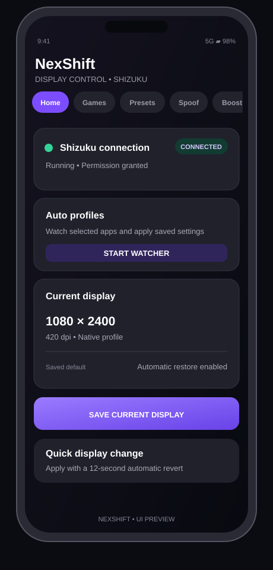
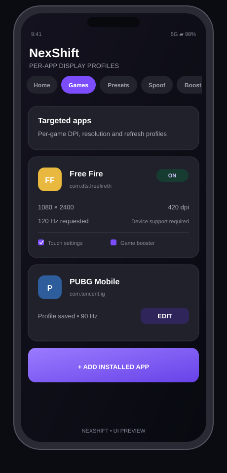
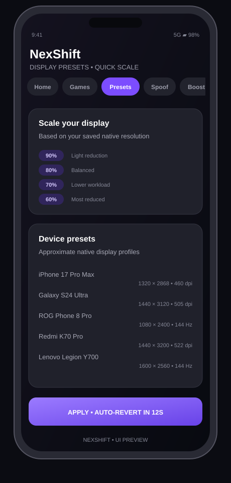

# NexShift

**Per-app Android display profiles and gaming setup tools, powered by Shizuku — no root required.**

NexShift helps you prepare different DPI, resolution and refresh-rate settings for selected apps, save your phone's original display configuration, and restore it when you leave a game. It is designed for Android 7.0+ and uses Shizuku to execute supported ADB-shell commands.

> **Experimental utility:** NexShift cannot guarantee higher FPS, bypass a game's own frame-rate cap, overclock hardware, or make a screen exceed its physical refresh-rate capability. Results depend on Android, device firmware and the game.

## App previews

These are illustrative UI mockups based on the app layout, not screenshots captured from a phone.

<p align="center">
  
  
  
</p>

## Features

- **Per-app profiles:** optional DPI, resolution and refresh-rate settings for games or other installed apps.
- **Automatic switching:** a foreground-app watcher can apply profiles when selected apps open and restore the saved display defaults when they close. Usage Access is needed for reliable app detection.
- **Display presets:** scale the saved resolution/DPI to 90%, 80%, 70% or 60%, or choose an approximate device preset.
- **12-second safety revert:** temporary manual display changes revert automatically unless you tap **Keep**.
- **Shizuku integration:** make supported system changes without requiring root.
- **Optional tuning:** Android game-mode requests, low-latency Wi-Fi mode, touch/animation settings, graphics/renderer scripts and backups for supported settings.
- **Device-profile entries:** try selected manufacturer-related settings. These do not universally spoof read-only hardware identity properties.
- **Appearance:** dark/light mode and configurable accent colour.

## Compatibility and limitations

- Android **7.0 (API 24)+**. The project targets Android 13 (API 33) and compiles against Android 14 (API 34).
- Shizuku must be installed, running and granted permission by the user.
- The automatic watcher needs Usage Access. Some Android builds restrict background services or usage events.
- Refresh values of 60/90/120/144/165 Hz are requests only; the panel and firmware must support the selected value.
- Bundled scripts are Android-version- and vendor-dependent. Unsupported commands may be ignored.
- **Thermal protection is intentionally left enabled.** Commands that attempt to weaken thermal safeguards are filtered before scripts run.
- The optional booster force-stops third-party background apps outside its keep-list. This can interrupt downloads, syncing or notifications, so it is opt-in.
- Settings backups can restore supported settings and properties. Force-stopping apps and trimming caches cannot be undone.

## Download the APK

1. Open **Actions** and select **Build APK**.
2. Choose **Run workflow**, or push a commit to start a build automatically.
3. Open the completed run and download the **NexShift-v1.0.1-debug** artifact.
4. Extract the ZIP to get `NexShift-v1.0.1-debug.apk`.

The artifact is debug-signed for testing; it is not a Play Store release.

## Build locally

The source archive is stored in numbered Base64 segments under `bundle/`. With JDK 17, Gradle 8.9 and the Android SDK installed:

```bash
cat bundle/part-*.b64 > NexShift-source.tar.xz.b64
base64 --decode NexShift-source.tar.xz.b64 > NexShift-source.tar.xz
tar -xJf NexShift-source.tar.xz
gradle assembleDebug
```

The APK is written to `app/build/outputs/apk/debug/app-debug.apk`.

## First-time setup

1. Install and start Shizuku (for example, through Wireless debugging).
2. Open NexShift and grant its Shizuku permission on the **Home** tab.
3. Save the current display as the default before testing overrides.
4. Create an app profile in **Games**, then start the watcher. Grant Usage Access if your Android build requires it.
5. Begin with conservative settings and use the automatic revert prompt if the display becomes difficult to use.

## Disclaimer

NexShift is provided as-is. Check each setting before applying it, avoid unfamiliar advanced scripts, and stop using a tweak if the phone becomes unusually warm, unstable or behaves unexpectedly.
